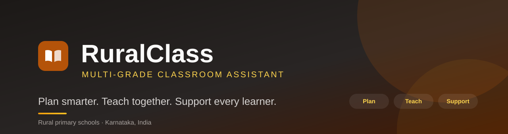
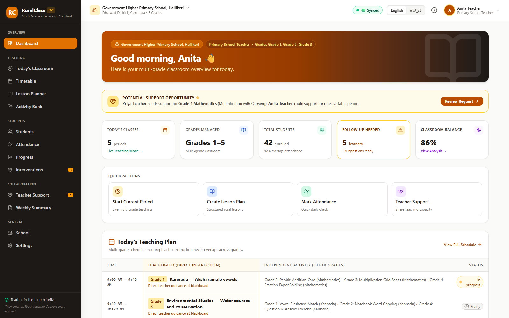
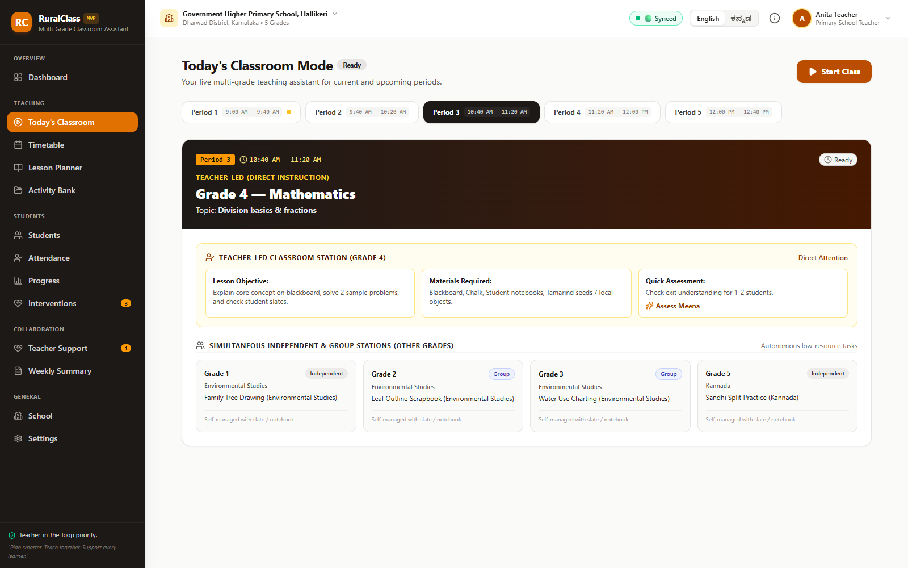
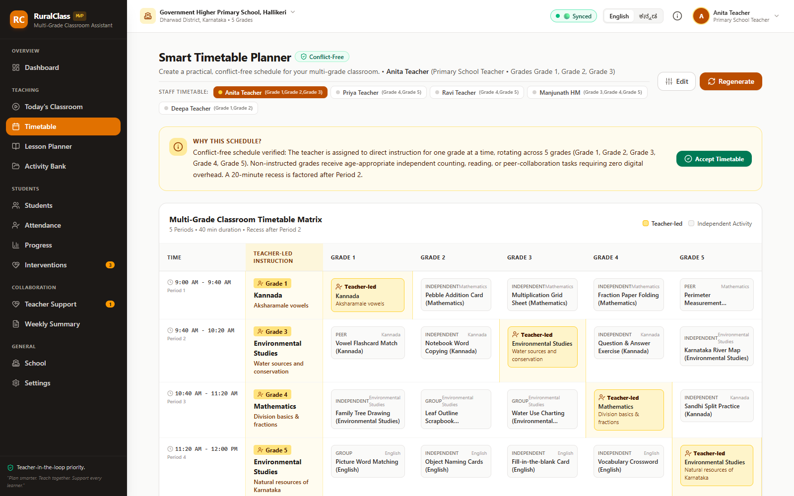
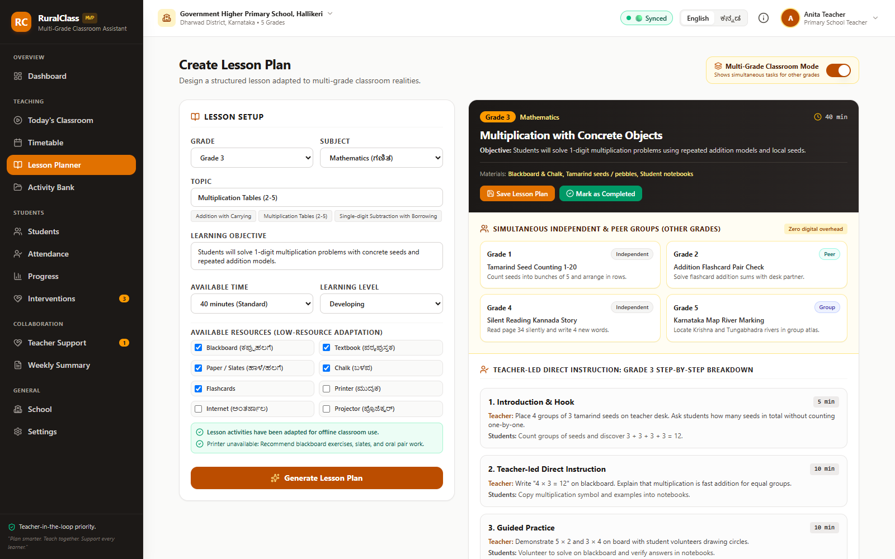
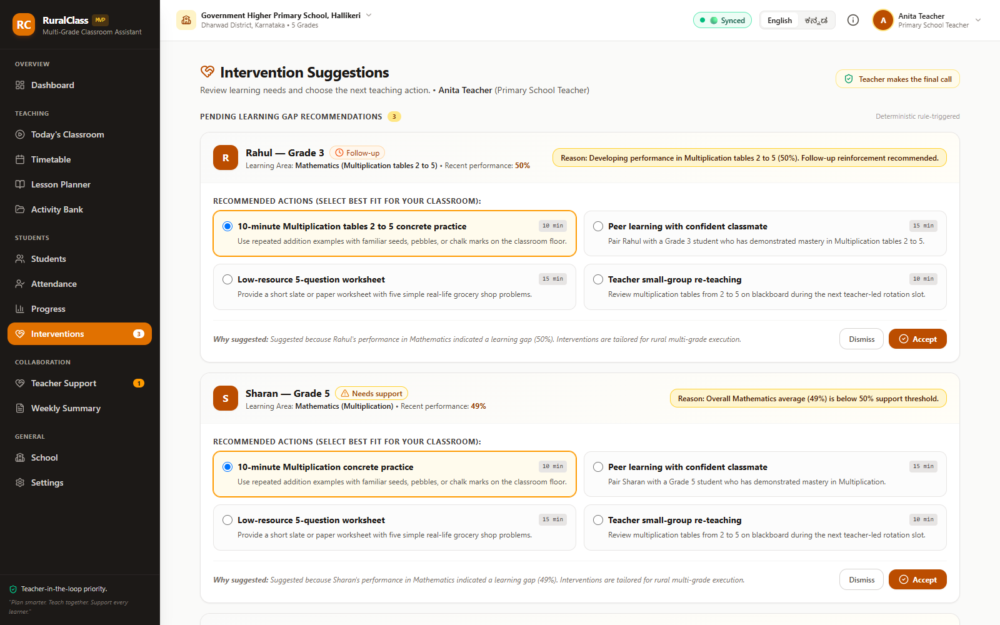
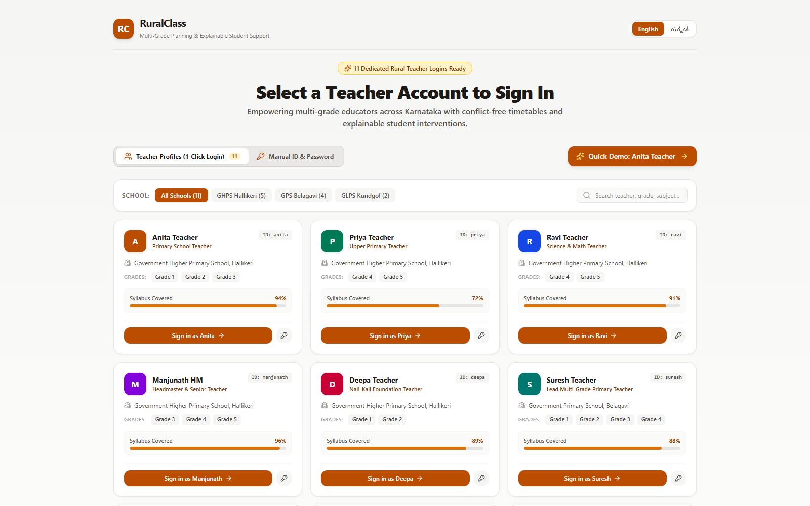
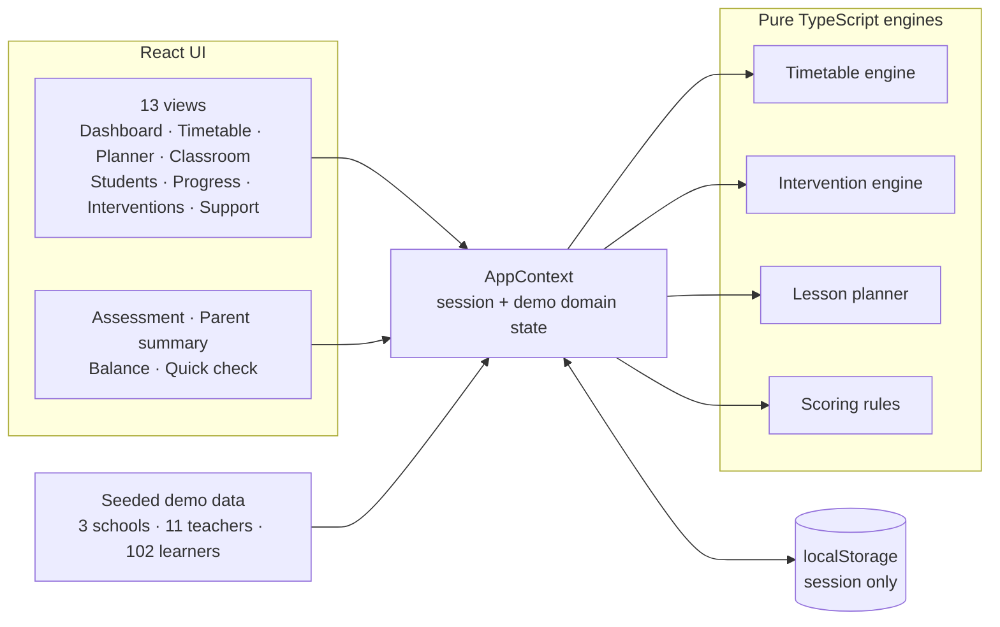

<div align="center">
  
</div>

# RuralClass

**A teacher-first planning and student-support workspace for multi-grade rural primary schools.**

[](https://react.dev)
[](https://www.typescriptlang.org)
[](https://vite.dev)
[](https://tailwindcss.com)
[](#tests-and-checks)
[](LICENSE)

RuralClass brings timetabling, lesson planning, classroom delivery, attendance, assessment and intervention follow-up into one calm workspace — designed for the reality of one teacher teaching several grades in the same room.

Built for rural primary schools in Karnataka, with a full **English / ಕನ್ನಡ** interface and a deterministic, explainable recommendation engine. No backend, API keys or network connection required for the demo.

**Hackathon pitch deck (six pages, one per judging criterion):** [PDF](pitch/RuralClass_Pitch_Deck.pdf) · [editable PPTX](pitch/RuralClass_Pitch_Deck.pptx) · [page map and 3-minute route](pitch/README.md)

> **Hackathon prototype.** All names, schools and learner records are fictional demo data. See [Demo data & scope](#demo-data--scope) before evaluating it as a production system.

---

## Table of contents

- [Why this exists](#why-this-exists)
- [What RuralClass does](#what-ruralclass-does)
- [Screenshots](#screenshots)
- [Feature tour](#feature-tour)
- [How the timetable is built](#how-the-timetable-is-built)
- [How interventions are decided](#how-interventions-are-decided)
- [Architecture](#architecture)
- [Tech stack](#tech-stack)
- [Getting started](#getting-started)
- [Deployment](#deployment)
- [Demo accounts](#demo-accounts)
- [Tests and checks](#tests-and-checks)
- [Project structure](#project-structure)
- [Design principles](#design-principles)
- [Demo data & scope](#demo-data--scope)
- [Roadmap](#roadmap)
- [Author and license](#author-and-license)

---

## Why this exists

In a multi-grade classroom, the difficult part is not the syllabus — it is the coordination. A teacher has to decide, period after period:

- Which grade receives direct instruction right now?
- What are the other four grades doing that is productive, independent and quiet enough?
- Which learners are falling behind, and what is the smallest useful next step for them?
- How do you keep attendance, assessment notes and parent conversations in one place when planning time is scarce?

Most edtech assumes one teacher per grade, reliable internet, and time to maintain yet another system. RuralClass starts from the opposite constraint: **one teacher, several grades, limited time, limited devices, unreliable connectivity.**

The product is deliberately built around three loops:

| Loop | Teacher outcome |
| --- | --- |
| **Plan** | A conflict-free multi-grade timetable and a lesson plan for every grade |
| **Teach** | A single screen that shows what this grade does while the others work |
| **Support** | Explainable, low-resource interventions the teacher can accept, edit or ignore |

---

## What RuralClass does

- **Conflict-free multi-grade timetables** — exactly one grade is teacher-led in every period, and every other grade receives a concrete independent, group or peer task.
- **Lessons built for the room, not the textbook** — timed lesson phases plus simultaneous activities for the other four grades.
- **Explainable student support** — deterministic rules surface learning gaps, state *why*, and offer four realistic 10–15 minute interventions.
- **One working day, one workspace** — attendance, quick assessments, teacher notes, parent summaries, colleague support requests and a weekly review.
- **Bilingual by design** — every core workflow has English and Kannada copy, including generated lesson content and interventions.
- **Low-resource first** — printable summaries, slate-and-chalk activities, and a UI that stays useful on a shared classroom tablet.

---

## Screenshots



<table>
  <tr>
    <td width="50%">
      
      <p align="center"><sub><b>Today's Classroom</b> — direct instruction for one grade, autonomous stations for the rest.</sub></p>
    </td>
    <td width="50%">
      
      <p align="center"><sub><b>Smart Timetable Planner</b> — every period verified, with the reasoning shown.</sub></p>
    </td>
  </tr>
  <tr>
    <td width="50%">
      
      <p align="center"><sub><b>Lesson Planner</b> — timed phases and activities for the other grades.</sub></p>
    </td>
    <td width="50%">
      
      <p align="center"><sub><b>Interventions</b> — the rule, the evidence, and four practical next steps.</sub></p>
    </td>
  </tr>
  <tr>
    <td width="50%">
      
      <p align="center"><sub><b>Demo sign-in</b> — 11 teacher profiles across three Karnataka schools.</sub></p>
    </td>
    <td width="50%">
      
      <p align="center"><sub><b>Kannada interface</b> — the same workflow, not a translated afterthought.</sub></p>
    </td>
  </tr>
</table>

---

## Feature tour

### Planning

- **Smart Timetable Planner** — configure grades, period count and period length; the school's subject list is used for the rotation. The engine generates a schedule where exactly one grade is teacher-led per period, assigns independent/group/peer work to the others, and adds a 20-minute recess after Period 2. The rationale is shown in plain language before the teacher accepts it.
- **Lesson Planner** — choose grade, subject, topic, available time, learning level and available resources. The planner produces a five-phase timed lesson (hook, direct instruction, guided practice, independent practice, exit check) with teacher and student actions, plus simultaneous multi-grade activities. Plans can be saved and marked complete.
- **Activity Bank** — a catalogue of low-resource activities tagged by grade, subject and grouping. Activities can be pulled directly into the day's timetable.
- **Classroom Balance** — a quick read on how instructional time is distributed across grades.

### Teaching

- **Today's Classroom** — a period-by-period teaching console: start class, see the teacher-led station for the current grade, see what every other grade should be doing, record completion status and observations, or reschedule the period.
- **Quick Assessment** — three observation questions turn a two-minute check into a recorded learning signal.
- **Attendance** — mark present/absent for the class and keep a running monthly view.
- **Students & profiles** — grade, attendance, subject levels, trends, teacher observations and notes in one record.
- **Parent summary** — a clean, printable summary of progress and next steps (browser print to PDF).
- **Teacher Support** — request cover or support from a colleague or coordinator, accept or decline requests, and track the handover.
- **Weekly Summary** — what was taught, where learners stand, and what needs attention next week.

### Support

- **Progress** — subject-level performance charts and class trends.
- **Interventions** — pending learning-gap suggestions with the triggering rule, the recent evidence, four low-resource options, accept/dismiss, and follow-up notes. The teacher always makes the final call.
- **School & settings** — school profile, staff roster, language and connectivity mode, and a reset for the demo data.

---

## How the timetable is built

The scheduler is a pure TypeScript function (`src/services/timetableEngine.ts`) with a hard invariant rather than a best-effort heuristic:

1. **Pick the teacher-led grade for the period.** Grades rotate round-robin, skipping the grade that was teacher-led in the previous period, so no grade gets two consecutive direct-instruction blocks.
2. **Choose a subject** by cycling the school's subject list, offset by the grade's position to avoid every period repeating the same pairing.
3. **Assign the teacher-led block** using a subject/grade activity template with topic copy in English and Kannada.
4. **Fill every other grade** with a pre-authored independent, group or peer task — counting with seeds, flashcard matching, notebook copying, map work — so non-instructed grades never wait for the teacher.
5. **Place the recess** after Period 2 and format each time slot (start time is 9:00 AM).
6. **Explain the result** in the UI: the teacher sees why the schedule is conflict-free before accepting it.

The invariant is enforced and tested: **exactly one `Teacher-led` activity per period**, for every generated period.

---

## How interventions are decided

There is no machine-learning model and no hidden score. `src/services/interventionEngine.ts` evaluates transparent rules against the learner's assessment history:

| Priority | Rule | Result |
| --- | --- | --- |
| 1 | Two most recent scores are both below 50% | **Needs support** |
| 2 | The latest score is below 50% | **Needs support** |
| 3 | The latest score is 50–59% | **Follow-up** |
| 4 | No assessments recorded, but a subject average is below 50% | **Needs support** |

The same thresholds drive the progress views (`src/utils/scoringRules.ts`):

| Average | Status |
| --- | --- |
| `< 50%` | Needs support |
| `50–70%` | Developing |
| `> 70%` | On track |

Every suggestion then gets four concrete choices — a 10-minute concrete practice, peer learning with a confident classmate, a low-resource worksheet, or teacher small-group re-teaching. Each is sized for a rural classroom and written in both languages. The teacher can accept, dismiss or add an observation; the system never acts on its own.

---

## Architecture

RuralClass is a client-side React application. Domain state lives in one place, and the decision logic is isolated in pure functions so it can be tested without a UI.



- **No server, no external API calls, no secrets.** `npm install && npm run dev` is the whole setup.
- **Engines are deterministic.** The timetable and intervention functions return the same output for the same input, which makes the behaviour explainable and testable.
- **State is intentionally local.** The demo session persists in `localStorage`; domain data is reseeded on reload. There is no live sync service behind the sync indicator.

---

## Tech stack

| Layer | Choice | Why |
| --- | --- | --- |
| UI | React 19 + TypeScript | Component model for a dense, multi-view teacher tool |
| Build | Vite 8 | Fast local feedback and a small static build |
| Styling | Tailwind CSS 4 | Consistent, responsive design without a component-library dependency |
| Icons | lucide-react | Small, legible icon set |
| Charts | Recharts | Progress and subject trends |
| Tests | `node:test` via `tsx` | Engine tests with no test-runner overhead |
| Hosting | Any static host | `dist/` is just HTML, CSS and JS |

---

## Getting started

**Prerequisites:** Node.js 20.19 or newer and npm.

```bash
git clone https://github.com/ShreeshaN2006/RuralClass.git
cd RuralClass
npm install
npm run dev
```

Open **http://localhost:3000**. No environment variables or API keys are needed.

Other commands:

```bash
npm run build       # production build into dist/
npm run preview     # serve the production build on http://localhost:4173
npm run typecheck   # TypeScript, no emit
npm test            # engine tests
npm run check       # typecheck + tests
```

---

## Deployment

RuralClass is a static site: `npm run build` produces a self-contained `dist/` folder that can be served from any static host.

### Render

The repository includes a [Render Blueprint](render.yaml) that configures the build, publish directory and SPA fallback:

[](https://render.com/deploy?repo=https://github.com/ShreeshaN2006/RuralClass)

To create the service manually, use these settings:

| Setting | Value |
| --- | --- |
| Service type | Static Site |
| Branch | `main` |
| Build command | `npm ci && npm run build` |
| Publish directory | `dist` |

Every push to `main` then triggers a new deploy. No environment variables or secrets are required.

### Other static hosts

Upload the contents of `dist/` after `npm run build`. For single-page hosting, rewrite unknown paths to `/index.html` so the app shell always loads.

---

## Demo accounts

The sign-in screen offers one-click access to all 11 teacher profiles. To use the manual form, any of these IDs works with the universal demo password **`demo123`** (prefix-free IDs such as `anita` are also accepted).

| School | Teacher ID | Name | Grades |
| --- | --- | --- | --- |
| Government Higher Primary School, Hallikeri | `teacher_anita` | Anita Teacher | 1–3 |
| Government Higher Primary School, Hallikeri | `teacher_priya` | Priya Teacher | 4–5 |
| Government Higher Primary School, Hallikeri | `teacher_ravi` | Ravi Teacher | 4–5 |
| Government Higher Primary School, Hallikeri | `teacher_manjunath` | Manjunath HM | 3–5 |
| Government Higher Primary School, Hallikeri | `teacher_deepa` | Deepa Teacher | 1–2 |
| Government Primary School, Belagavi | `teacher_suresh` | Suresh Teacher | 1–4 |
| Government Primary School, Belagavi | `teacher_meena` | Meena Teacher | 1–3 |
| Government Primary School, Belagavi | `teacher_basavaraj` | Basavaraj Teacher | 3–4 |
| Government Primary School, Belagavi | `teacher_kavitha` | Kavitha Teacher | 1, 2, 4 |
| Government Lower Primary School, Kundgol | `teacher_renuka` | Renuka Teacher | 1–3 |
| Government Lower Primary School, Kundgol | `teacher_prakash` | Prakash Teacher | 2–3 |

> Demo authentication is intentionally permissive and must be replaced before any real deployment.

---

## Tests and checks

```bash
npm run check
```

The suite covers the parts where a regression would silently harm a teacher's day:

- **Authentication** — one-click profiles, ID/email lookup, prefix-free IDs, invalid password and unknown account paths.
- **Scoring rules** — status thresholds and consecutive-low-score detection.
- **Intervention engine** — explainable triggers, status, and the four generated options.
- **Timetable engine** — the exact-one-teacher-led-grade invariant across every period, and the no-grades guard.

Current status: **13 tests passing**, TypeScript clean, production build successful.

---

## Project structure

```text
RuralClass/
├── docs/
│   ├── banner.svg              # README banner
│   ├── product-brief.md        # Original hackathon product brief
│   └── screenshots/            # README screenshots
├── pitch/                      # Hackathon pitch deck (PDF + editable PPTX)
├── public/
│   └── favicon.svg
├── src/
│   ├── components/             # Shell, sidebar, topbar, modals, shared UI
│   ├── context/                # AppContext: session + demo domain state
│   ├── data/                   # Seeded schools, teachers, learners, plans
│   ├── pages/                  # 13 navigation views + sign-in
│   ├── services/               # Timetable, intervention and lesson engines
│   ├── types/                  # Domain types
│   ├── utils/                  # Scoring rules and EN/KN translations
│   ├── App.tsx
│   ├── index.css
│   └── main.tsx
├── index.html
├── package.json
├── tsconfig.json
└── vite.config.ts
```

---

## Design principles

1. **Teacher in the loop.** Suggestions are advisory. Interventions must be accepted, and every generated timetable is presented with its rationale and can be accepted, regenerated or edited.
2. **Explain before recommending.** A recommendation without its reason is not actionable, so the triggering rule and the evidence are always shown.
3. **Low-resource by default.** No printer, projector or internet assumption. Activities use slates, seeds, stones, notebook work and the blackboard.
4. **Bilingual parity.** Kannada is a first-class interface language, including generated lesson phases and intervention descriptions.
5. **Data minimisation.** No Aadhaar numbers, phone numbers or sensitive personal data are modelled. Learner records are limited to what a teacher needs to act.
6. **Calm, legible UI.** Dense information is grouped into cards and tables with clear status colours, and the same structure is used across every view.

---

## Demo data & scope

This repository is a **front-end hackathon prototype**, not a production school system.

- All schools, teachers and learners are fictional. The seed data lives in `src/data/mockData.ts`.
- There is **no backend, database or external AI/API integration**. Everything runs in the browser.
- The demo session is stored in `localStorage`; changes to attendance, plans and interventions are held in React state and reset on reload (Settings → Reset demo data also resets them).
- Authentication is a local, permissive demo check — it is not security.
- The connectivity/sync indicator is a UX demonstration of the intended offline-first behaviour, not a real sync engine.

---

## Roadmap

- Persist the working day locally (IndexedDB) and add a real offline-first sync/conflict layer.
- Replace demo auth with school-managed accounts and role boundaries (teacher, head teacher, coordinator).
- Export timetable and weekly packs to print-ready PDF.
- Add a coordinator view for cross-school support requests and coverage.
- Accessibility pass: keyboard navigation, focus order, reduced motion and screen-reader labels.
- Split the single bundle by route and lazy-load chart-heavy views.
- Add more languages and a voice-assisted quick assessment flow for low-literacy settings.

---

## Author and license

Built by **[Shreesha N.](https://github.com/ShreeshaN2006)** for a rural education hackathon.

The original product brief that shaped the scope is in [docs/product-brief.md](docs/product-brief.md).

Released under the [MIT License](LICENSE).
